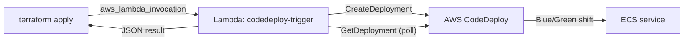

<div align="center">
  

  <h1>aws-lambda-codedeploy-trigger</h1>

  <p>
    <strong>Trigger AWS CodeDeploy from <code>terraform apply</code> — synchronously.</strong>
  </p>

  <p>
    <a href="https://github.com/dmitryint/aws-lambda-codedeploy-trigger/actions/workflows/test.yml"></a>
    <a href="https://github.com/dmitryint/aws-lambda-codedeploy-trigger/releases/latest"></a>
    <a href="https://goreportcard.com/report/github.com/dmitryint/aws-lambda-codedeploy-trigger"></a>
    <a href="https://github.com/dmitryint/aws-lambda-codedeploy-trigger/blob/main/LICENSE"></a>
    
    
  </p>
</div>

---

## Why this exists

Terraform can create CodeDeploy applications and deployment groups, but **it cannot start a deployment**. With ECS Blue/Green that means changing your task definition in Terraform leaves the live service untouched until somebody manually clicks *Deploy*. There is no `aws_codedeploy_deployment` resource and `aws_ecs_service` with the `CODE_DEPLOY` controller will not roll out new task revisions on its own.

This Lambda closes the loop:

1. Terraform builds the new task definition / AppSpec.
2. `aws_lambda_invocation` calls this Lambda with the AppSpec.
3. The Lambda creates a CodeDeploy deployment and **waits** until it Succeeds or Fails.
4. `terraform apply` blocks until the deployment finishes — success or non-zero exit.



The same Lambda also drives **Amazon ECS native deployments** — services that use the `ECS` deployment controller with any deployment strategy, including the built-in `BLUE_GREEN`. Terraform registers the new task definition, the Lambda calls `UpdateService` and waits on the service deployment that call started, and `terraform apply` fails if ECS rolls it back.

## Features

- Synchronous: blocks `terraform apply` until the deployment reaches a terminal state.
- Returns structured JSON (`deploymentId`, `status`, timestamps) — readable from `aws_lambda_invocation.<name>.result`.
- Optional fire-and-forget mode (`wait: false`).
- Configurable poll interval (`POLL_INTERVAL_SECONDS`).
- Forwards every CodeDeploy `CreateDeployment` knob you commonly need: description, auto-rollback, ignore application stop failures.
- Amazon ECS native deployments (`ROLLING`, `BLUE_GREEN`, `LINEAR`, `CANARY`): `UpdateService`, then waits on the started service deployment and fails on rollback or stop.
- Single static binary, `provided.al2023` runtime, ~5 MB zipped, supports `arm64` and `x86_64`.

## Quick start (Terraform + ECS Blue/Green)

The exact pattern this project is designed for:

```hcl
locals {
  appspec = {
    version = "0.0"
    Resources = [{
      TargetService = {
        Type = "AWS::ECS::Service"
        Properties = {
          TaskDefinition = module.ecs_service.task_definition_arn
          LoadBalancerInfo = {
            ContainerName = local.container_name
            ContainerPort = local.container_port
          }
          PlatformVersion = "LATEST"
        }
      }
    }]
  }
}

resource "aws_lambda_invocation" "deploy" {
  function_name = var.codedeploy_lambda_function_name

  input = jsonencode({
    applicationName     = module.code_deploy.name
    deploymentGroupName = module.code_deploy.name
    revision = {
      revisionType = "AppSpecContent"
      appSpecContent = {
        content = jsonencode(local.appspec)
        sha256  = sha256(jsonencode(local.appspec))
      }
    }
  })

  triggers = {
    task_definition_arn = module.ecs_service.task_definition_arn
  }

  depends_on = [
    module.code_deploy,
    module.ecs_service,
    module.alb_ingress,
  ]
}

output "deployment_id" {
  value = jsondecode(aws_lambda_invocation.deploy.result).deploymentId
}
```

## Quick start (Terraform + ECS native blue/green)

For a service with `deployment_controller { type = "ECS" }` and `deployment_configuration { strategy = "BLUE_GREEN" }`, let Terraform ignore `task_definition` on the service and hand each new revision to the Lambda:

```hcl
resource "aws_lambda_invocation" "deploy" {
  function_name = var.codedeploy_lambda_function_name

  input = jsonencode({
    cluster        = "my-cluster"
    service        = "my-service"
    taskDefinition = aws_ecs_task_definition.this.arn
  })

  triggers = {
    task_definition_arn = aws_ecs_task_definition.this.arn
  }
}

output "service_deployment_arn" {
  value = jsondecode(aws_lambda_invocation.deploy.result).serviceDeploymentArn
}
```

End-to-end runnable examples:

- [`examples/terraform/`](examples/terraform) — provision the Lambda function from a release artifact.
- [`examples/terraform-ecs-blue-green/`](examples/terraform-ecs-blue-green) — full ECS Blue/Green flow through CodeDeploy.
- [`examples/terraform-ecs-native-blue-green/`](examples/terraform-ecs-native-blue-green) — ECS native blue/green service driven by the ECS trigger.

## Event schema

The handler accepts one of two event variants. Set exactly one of `applicationName` (CodeDeploy) and `service` (ECS); an event with both, or with neither, is rejected with a validation error.

### CodeDeploy

Keys match the AWS CodeDeploy `CreateDeployment` API in lower-camel-case.

| Field | Type | Required | Description |
|---|---|---|---|
| `applicationName` | string | yes | CodeDeploy application name. |
| `deploymentGroupName` | string | yes | CodeDeploy deployment group name. |
| `revision` | object | yes | A standard CodeDeploy [`RevisionLocation`](https://docs.aws.amazon.com/codedeploy/latest/APIReference/API_RevisionLocation.html). For ECS Blue/Green use `revisionType: "AppSpecContent"`. |
| `description` | string | no | Description attached to the deployment. |
| `ignoreApplicationStopFailures` | bool | no | Forwarded to `CreateDeployment`. |
| `autoRollbackConfiguration` | object | no | CodeDeploy [`AutoRollbackConfiguration`](https://docs.aws.amazon.com/codedeploy/latest/APIReference/API_AutoRollbackConfiguration.html). |
| `wait` | bool | no | Default `true`. Set to `false` to return immediately after `CreateDeployment` without polling. |

### Amazon ECS

Keys match the Amazon ECS [`UpdateService`](https://docs.aws.amazon.com/AmazonECS/latest/APIReference/API_UpdateService.html) API in lower-camel-case. The service must use the `ECS` deployment controller.

| Field | Type | Required | Description |
|---|---|---|---|
| `cluster` | string | yes | Cluster name or ARN. |
| `service` | string | yes | Service name or ARN. |
| `taskDefinition` | string | yes, unless `forceNewDeployment` is `true` | `family:revision` or full ARN of the task definition to roll out. |
| `forceNewDeployment` | bool | no | Start a new deployment even if the service definition is unchanged. |
| `wait` | bool | no | Default `true`. Set to `false` to return right after `UpdateService` without polling. |

The handler reads the service with `DescribeServices`, calls `UpdateService`, and identifies the service deployment that call started by comparing the service's `currentServiceDeployment` before and after. It then polls `DescribeServiceDeployments` every `POLL_INTERVAL_SECONDS`:

- `SUCCESSFUL` returns a result.
- `ROLLBACK_SUCCESSFUL`, `ROLLBACK_FAILED` and `STOPPED` return an error with the service deployment ARN, status, status reason and last lifecycle stage.
- Any other status keeps polling.

If `UpdateService` started no new deployment (the requested task definition is already the service's and `forceNewDeployment` is not set), the result has `noOp: true`. When the service's current deployment is still in progress, the handler waits for it like for a new one. When it already ended in a rollback or stop, the handler returns an error, because the requested revision is not known to be running; set `forceNewDeployment` to deploy it again.

## Result schema

```json
{
  "deploymentId": "d-XXXXXXXXX",
  "status": "Succeeded",
  "createdAt": "2026-05-09T10:00:00Z",
  "completedAt": "2026-05-09T10:05:30Z"
}
```

A failed deployment returns the same shape **plus** a non-empty `errorMessage` field on the Lambda invocation, which causes `aws_lambda_invocation` to fail the Terraform run.

An ECS deployment returns the same keys plus the ECS details:

```json
{
  "deploymentId": "arn:aws:ecs:us-east-1:123456789012:service-deployment/my-cluster/my-service/AbCdEf0123456789",
  "status": "SUCCESSFUL",
  "createdAt": "2026-05-09T10:00:00Z",
  "completedAt": "2026-05-09T10:09:30Z",
  "trigger": "ecs",
  "serviceDeploymentArn": "arn:aws:ecs:us-east-1:123456789012:service-deployment/my-cluster/my-service/AbCdEf0123456789",
  "lifecycleStage": "CLEAN_UP"
}
```

| Field | Trigger | Description |
|---|---|---|
| `deploymentId` | both | CodeDeploy deployment ID, or the ECS service deployment ARN. |
| `status` | both | Last observed status. CodeDeploy: `Created` with `wait: false`, then `Succeeded`, `Failed`, `Stopped`. ECS: `PENDING` with `wait: false` (empty for a no-op), then the service deployment status. |
| `createdAt`, `completedAt` | both | RFC 3339 timestamps. For ECS they come from the service deployment's `createdAt` and `finishedAt` (or `stoppedAt`). |
| `trigger` | both | `codedeploy` or `ecs`. |
| `serviceDeploymentArn` | ECS | Service deployment the handler waited on. Omitted when the service has no deployment history. |
| `lifecycleStage` | ECS | Last observed lifecycle stage, e.g. `BAKE_TIME`, `CLEAN_UP`. |
| `statusReason` | ECS | Reason ECS gave for the status, if any. |
| `noOp` | ECS | `true` when `UpdateService` started no new deployment. |

## Configuration

| Env var | Default | Description |
|---|---|---|
| `POLL_INTERVAL_SECONDS` | `15` | Interval between `GetDeployment` (CodeDeploy) or `DescribeServiceDeployments` (ECS) polls. Lower it for faster feedback on small deployments. |

The AWS region is taken from the standard Lambda environment — no extra variables required.

## IAM policy for the Lambda role

CodeDeploy trigger:

```json
{
  "Version": "2012-10-17",
  "Statement": [
    {
      "Effect": "Allow",
      "Action": [
        "codedeploy:CreateDeployment",
        "codedeploy:GetDeployment",
        "codedeploy:GetDeploymentConfig",
        "codedeploy:RegisterApplicationRevision"
      ],
      "Resource": "*"
    },
    {
      "Effect": "Allow",
      "Action": "iam:PassRole",
      "Resource": "arn:aws:iam::*:role/<codedeploy-service-role>"
    }
  ]
}
```

ECS trigger, scoped to one service:

```json
{
  "Version": "2012-10-17",
  "Statement": [
    {
      "Effect": "Allow",
      "Action": [
        "ecs:DescribeServices",
        "ecs:UpdateService"
      ],
      "Resource": "arn:aws:ecs:us-east-1:123456789012:service/my-cluster/my-service"
    },
    {
      "Effect": "Allow",
      "Action": "ecs:DescribeServiceDeployments",
      "Resource": [
        "arn:aws:ecs:us-east-1:123456789012:service/my-cluster/my-service",
        "arn:aws:ecs:us-east-1:123456789012:service-deployment/my-cluster/my-service/*"
      ]
    },
    {
      "Effect": "Allow",
      "Action": "iam:PassRole",
      "Resource": [
        "arn:aws:iam::123456789012:role/my-service-task",
        "arn:aws:iam::123456789012:role/my-service-execution"
      ],
      "Condition": {
        "StringEquals": {
          "iam:PassedToService": "ecs-tasks.amazonaws.com"
        }
      }
    }
  ]
}
```

`DescribeServiceDeployments` is authorized against both the service and the service deployment resource, so it needs both ARNs. The [Service Authorization Reference](https://docs.aws.amazon.com/service-authorization/latest/reference/list_ecs.html) lists `iam:PassRole` (with `iam:PassedToService` `ecs-tasks.amazonaws.com` or `ecs.amazonaws.com`) among the permissions `UpdateService` authorizes, but the AWS documentation does not say whether it is evaluated for a request that only changes the task definition. Grant it for the task role and task execution role of the task definitions you deploy, as above. The Lambda never passes the ECS infrastructure role for load balancers, because it does not send `loadBalancers` to `UpdateService`.

Plus the standard `AWSLambdaBasicExecutionRole` for CloudWatch Logs.

## Known constraints

- **AWS Lambda hard limit of 15 minutes.** If your deployment can take longer (large fleets, slow Blue/Green traffic shifts), either tune CodeDeploy `wait_time_in_minutes` and the deployment configuration to fit, or invoke the Lambda with `wait: false` and poll deployment status from elsewhere.
- `aws_lambda_invocation` re-runs on **every** change to its `triggers` map. Keep `triggers` precise (e.g. `task_definition_arn`) to avoid spurious deployments.
- When it waits, the handler stops 5 seconds before the Lambda timeout so the error with the deployment ID and last status reaches the caller instead of a bare `Task timed out`.
- ECS native blue/green: task start-up, test and production traffic shifts, lifecycle hooks and `bakeTimeInMinutes` must all fit into one invocation.
- ECS detects failed deployments with the [deployment circuit breaker or CloudWatch alarms](https://docs.aws.amazon.com/AmazonECS/latest/developerguide/deployment-failure-detection.html). Enable one of them with rollback on the service so a bad revision ends in `ROLLBACK_SUCCESSFUL` and fails the apply.
- The ECS trigger needs the `ECS` deployment controller. Services on `CODE_DEPLOY` use the CodeDeploy trigger; `EXTERNAL` is not supported.

## Releases

Each tagged GitHub Release ships two ready-to-use Lambda zip artifacts:

- `lambda-codedeploy-trigger_<version>_linux_amd64.zip`
- `lambda-codedeploy-trigger_<version>_linux_arm64.zip`

Pin a version in your Terraform config and download via `archive_file`, `null_resource` + `curl`, or by uploading to S3.

## Building from source

```sh
git clone https://github.com/dmitryint/aws-lambda-codedeploy-trigger.git
cd aws-lambda-codedeploy-trigger
make package          # builds amd64 + arm64 zips into ./package
make test             # runs unit tests with -race
```

## Contributing

Issues and pull requests are welcome. See [CONTRIBUTING.md](CONTRIBUTING.md) for the development workflow, coding conventions, and PR checklist.

## License

[MIT](LICENSE) © 2026 Dmitry K.
